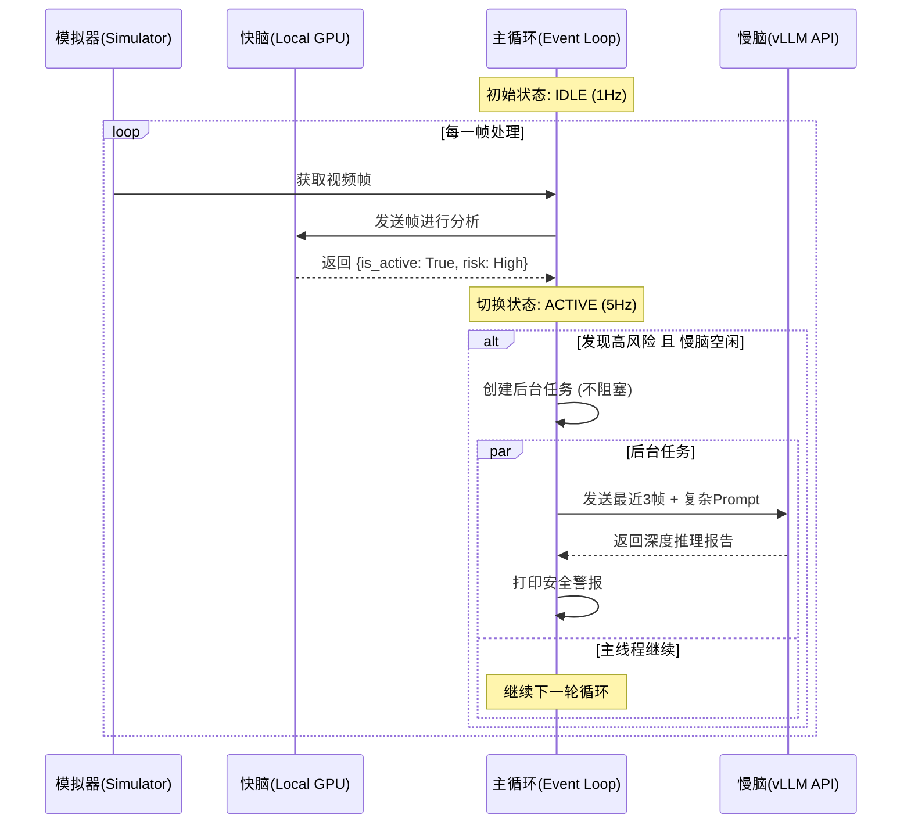

# 双脑协同视频安全监测系统代码文档

## 1. 系统概述

本系统旨在解决传统大模型在视频监控中面临的“实时性”与“准确性”难以兼得的矛盾。系统采用**双脑架构**：

*   **快脑 (Fast Brain)**：使用轻量级多模态模型（MiniCPM-o 4.5），在本地运行。负责**高频、低延迟**的实时监控，判断画面中是否有动作或异常。
*   **慢脑 (Slow Brain)**：使用超大参数多模态模型（Qwen3-VL-30B），通过 vLLM API 调用。负责**低频、深层推理**，仅在快脑发出“高风险”预警时介入，进行详细的物理安全分析。

整个系统由 `asyncio` 异步框架驱动，确保在慢脑进行耗时推理时，视频流的监控不会中断。

---

## 2. 核心模块详解

### 2.1 全局配置与依赖
代码首先定义了运行所需的配置项：
*   **`VIDEO_PATH`**: 待检测的视频文件路径。
*   **`DEVICE_FAST`**: 快脑运行的显卡（如 `cuda:0`）。
*   **`VLLM_API_URL`**: 慢脑 vLLM 服务的 API 地址（OpenAI 兼容接口）。
*   **频率配置**:
    *   `FREQ_IDLE` (1Hz): 画面静止时的低采样率，节省算力。
    *   `FREQ_ACTIVE` (5Hz): 检测到动作时的高采样率，捕捉细节。

### 2.2 快脑模块 (`FastBrain` 类)
**职责**：直觉反应系统，类似人的“反射神经”。

*   **初始化**: 加载 `openbmb/MiniCPM-o-4_5` 模型。
    *   *优化点*：关闭了音频 (`init_audio=False`) 和 TTS 模块，专注于视觉任务以提升速度。
    *   *预填充*：使用 `streaming_prefill` 预置 System Prompt，定义输出必须为 JSON 格式。
*   **流式分析 (`analyze_chunk`)**:
    *   **输入**: 接收单帧 PIL 图片。
    *   **推理**: 使用 `streaming_generate` 进行流式生成。设置 `omni_mode=True` 维持多模态流的上下文记忆。
    *   **输出解析**: 尝试将模型生成的文本解析为 JSON 对象（包含 `is_active`, `risk_level` 等字段）。如果解析失败，有兜底逻辑。

### 2.3 慢脑模块 (`SlowBrain` 类)
**职责**：逻辑推理系统，类似人的“大脑皮层”。

*   **初始化**: 创建一个 OpenAI 兼容的客户端，连接到本地或远程部署的 vLLM 服务。
*   **图像处理 (`_image_to_base64`)**: 将 PIL 图片转换为 Base64 编码，因为 HTTP API 通常不直接支持二进制流传输。
*   **深度推理 (`deep_reason`)**:
    *   **输入**: 接收一组图片（多帧上下文）。
    *   **Prompt**: 使用复杂的 Prompt，要求模型识别物体材质、空间关系，并预测因果后果（如“起火”、“泄露”）。
    *   **调用**: 发送 HTTP 请求给 vLLM，等待响应。这是一个**阻塞式**的 I/O 操作（但在主流程中会被异步封装）。

### 2.4 视频流模拟器 (`FileStreamSimulator` 类)
**职责**：模拟摄像头的实时数据流。

*   **变频采样 (`get_next_frame`)**:
    *   不只是简单地逐帧读取，而是根据传入的 `target_freq`（目标频率）计算需要跳过多少帧。
    *   *作用*：当系统处于 `FREQ_IDLE` (1Hz) 时，模拟器会快速跳过中间的帧，模拟真实时间的流逝，避免处理无用数据。

### 2.5 系统编排器 (`DualBrainSystem` 类)
**职责**：系统的核心大脑，协调快慢脑的工作流。

*   **组件**: 持有快脑实例、慢脑客户端、模拟器、帧缓冲区 (`deque`) 和一个异步锁 (`asyncio.Lock`)。
*   **主循环 (`run` 方法)**:
    1.  **获取帧**: 从模拟器获取当前帧。
    2.  **快脑扫描**: 调用快脑进行快速分析。
    3.  **动态频率调整**:
        *   如果快脑说 `is_active=True`，将采样频率提升至 5Hz。
        *   否则保持 1Hz。
    4.  **慢脑触发机制**:
        *   **条件**: 快脑判定 `risk_level="high"` **且** 慢脑当前空闲（锁未被占用）。
        *   **动作**: 从缓冲区提取最近的几帧（上下文），通过 `asyncio.create_task` 启动一个**后台任务**去请求慢脑。
        *   *关键点*：这里**不会等待**慢脑返回，主循环继续处理下一帧视频，实现了“监控不卡顿”。
*   **异步推理 (`_async_reasoning` 方法)**:
    *   获取锁 (`async with self.monitor_lock`)，确保同一时间只有一个慢脑请求在处理。
    *   使用 `loop.run_in_executor` 将同步的 API 调用（`self.slow.deep_reason`）放入线程池执行，避免阻塞 `asyncio` 的事件循环。
    *   收到结果后打印详细的安全报告。

---

## 3. 工作流程图解



---

## 4. 代码的关键技术点

1.  **异步非阻塞 (Asyncio)**:
    *   这是实现实时监控的核心。慢脑的推理可能需要 5-10 秒，如果直接等待，视频画面就会卡死 10 秒。
    *   代码使用 `asyncio.create_task` 将慢脑请求“扔”到后台，主程序继续跑快脑监控。

2.  **变频采样 (Adaptive Sampling)**:
    *   通过 `FileStreamSimulator` 实现。
    *   **静止时**：1秒看1眼，极低功耗。
    *   **运动时**：1秒看5眼，捕捉瞬间动作。
    *   这模拟了生物的注意力机制。

3.  **显存分离策略**:
    *   **快脑**：加载在本地 GPU (`cuda:0`)，显存占用固定。
    *   **慢脑**：通过 HTTP API 调用。这意味着慢脑可以部署在另一张卡、另一台机器，甚至云端。这解决了单卡显存不足以同时跑两个大模型的问题。

4.  **上下文管理**:
    *   `self.frame_buffer = deque(maxlen=20)`：始终保留最近的 20 帧画面。
    *   当慢脑介入时，不仅仅看当前这一帧，而是提取过去几秒的帧（`list(self.frame_buffer)[-5::2]`），让慢脑能理解动作的**连贯性**（例如：机器人是把杯子拿起来，还是扔出去）。

## 5. 运行指南

1.  **启动慢脑服务**:
    在运行此脚本之前，您必须先启动 vLLM 服务端（建议在另一个终端或另一台机器上）：
    ```bash
    # 示例启动命令
    vllm serve Qwen/Qwen3-VL-30B-A3B-Thinking-Instruct \
      --trust-remote-code \
      --port 8000 \
      --tensor-parallel-size 2 # 根据你的显卡数量调整
    ```

2.  **配置脚本**:
    修改脚本顶部的配置：
    ```python
    VIDEO_PATH = "/path/to/your/video.mp4"
    VLLM_API_URL = "http://localhost:8000/v1" # 确保地址对应
    ```

3.  **运行**:
    ```bash
    python your_script_name.py
    ```

## 6. 总结
这段代码实现了一个高效的**端云协同（或大小模型协同）**范式。它利用小模型的速度来过滤 99% 的无用帧，利用大模型的智商来处理 1% 的关键危机时刻，是目前多模态视频理解落地的最佳实践之一。