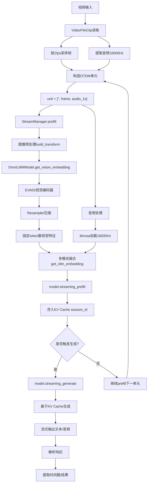

# MiniCPM-V 项目代码结构详解与流式视频理解 Pipeline

## 目录
1. [核心模块文件功能详解](#核心模块文件功能详解)
2. [流式视频理解 Pipeline 信息流](#流式视频理解-pipeline-信息流)
3. [关键函数调用链](#关键函数调用链)
4. [文件功能总览表](#文件功能总览表)

---

## 文件功能总览表

| 文件路径 | 行数 | 主要功能 | 关键类/函数 | 在 Pipeline 中的作用 |
|---------|------|---------|-----------|-------------------|
| **模型架构层** |
| `omnilmm/model/omnilmm.py` | 456 | 定义 OmniLMM 模型架构 | `OmniLMMModel`, `get_vision_embedding()` | 视觉编码、多模态融合 |
| `omnilmm/model/resampler.py` | 172 | 视觉特征压缩 | `Resampler.forward()` | 将图像特征压缩到固定 tokens |
| `omnilmm/model/utils.py` | 556 | 图像预处理工具 | `build_transform()` | 图像预处理 pipeline |
| **流式处理层** |
| `web_demos/minicpm-o_2.6/model_server.py` | 937 | ⭐ 流式处理核心 | `StreamManager.prefill()`, `generate()` | OTDM 单元构造、流式生成 |
| `web_demos/minicpm-o_2.6/vad_utils.py` | 302 | 语音活动检测 | `SileroVADModel`, `run_vad()` | 检测语音开始/结束 |
| `web_demos/minicpm-o_2.6/chatbot_web_demo_o2.6.py` | 553 | Web UI 演示 | `encode_video()`, `respond()` | 用户界面交互 |
| **应用层** |
| `test_minicpm_o_danger_detection.py` | 378 | 危险检测测试 | `analyze_video_streaming()` | 实际应用示例 |
| `chat.py` | 293 | 统一模型接口 | `MiniCPMV2_6`, `OmniLMM12B` | 不同模型版本的封装 |
| **工具层** |
| `omnilmm/utils.py` | 128 | 工具函数 | `build_logger()`, `disable_torch_init()` | 日志、初始化工具 |
| `omnilmm/conversation.py` | 321 | 对话管理 | `Conversation` | 对话模板和格式 |
| `omnilmm/train/train_utils.py` | 154 | 训练预处理 | `omni_preprocess()` | 训练数据预处理 |
| `omnilmm/constants.py` | 5 | 常量定义 | - | 配置常量 |

---

## 核心模块文件功能详解

### 一、模型架构层 (`omnilmm/model/`)

#### 1. `omnilmm/model/omnilmm.py` (456行)
**功能**：定义 OmniLMM 模型的核心架构

**主要类和函数**：

- **`OmniLMMConfig`** (23-24行)
  - 继承自 `MistralConfig`
  - 定义模型配置参数

- **`create_vision_module(config)`** (32-53行)
  - 创建视觉编码器和 Resampler
  - 使用 EVA02 作为视觉编码器（`eva02_enormous_patch14_clip_224.laion2b_plus`）
  - 创建 Resampler 将视觉特征压缩到固定 token 数

- **`OmniLMMModel`** (56-266行)
  - 继承自 `MistralModel`
  - **`get_vision_embedding(pixel_values)`** (108-121行)
    - 核心视觉编码函数
    - 流程：`vision_tower.forward_features()` → 移除 prefix tokens → `resampler()` 压缩
  - **`get_vllm_embedding(data)`** (123-182行)
    - 处理多模态输入，将视觉特征嵌入到文本序列中
    - 处理 `<im_start>` 和 `<im_end>` tokens
  - **`forward()`** (184-266行)
    - 模型前向传播
    - 处理图像和文本的融合

- **`OmniLMMForCausalLM`** (269-454行)
  - 继承自 `MistralForCausalLM`
  - **`forward()`** (283-347行)：计算损失和 logits
  - **`generate_vllm()`** (372-397行)：用于 vLLM 推理的生成函数
  - **`initialize_vision_tokenizer()`** (400-453行)：初始化视觉相关的特殊 tokens

**关键作用**：提供模型的基础架构，支持多模态输入（图像+文本）的编码和融合

---

#### 2. `omnilmm/model/resampler.py` (172行)
**功能**：实现 Perceiver-style 的视觉特征压缩

**主要类**：

- **`Resampler`** (96-172行)
  - **`__init__()`** (104-138行)
    - 初始化可学习的 query 参数
    - 创建 2D 位置编码（sincos）
    - 定义 cross-attention 层
  - **`forward(x, attn_mask=None)`** (149-168行)
    - 核心压缩函数
    - 使用 cross-attention 将任意数量的视觉 tokens 压缩到固定数量（`grid_size²`）
    - 流程：`kv_proj` → `ln_kv` → cross-attention → `ln_post` → `proj`

**关键作用**：将不同分辨率的图像特征统一压缩到固定 token 数，支持混合分辨率编码策略

---

#### 3. `omnilmm/model/utils.py` (556行)
**功能**：提供图像预处理、数据增强等工具函数

**主要函数**：

- **`build_transform()`** (421-462行)
  - 构建图像预处理 pipeline
  - 支持训练/推理模式
  - 使用 OPENAI_CLIP 或 IMAGENET_INCEPTION 标准化

- **`auto_upgrade()`** (23-39行, 61-77行)
  - 自动升级旧版 checkpoint 配置

- **数据增强函数** (82-418行)
  - `autocontrast_func`, `equalize_func`, `rotate_func` 等
  - 用于训练时的数据增强

**关键作用**：提供图像预处理和增强功能，确保输入格式符合模型要求

---

### 二、工具和配置层 (`omnilmm/`)

#### 4. `omnilmm/utils.py` (128行)
**功能**：提供日志、工具函数

**主要函数**：

- **`build_logger()`** (17-57行)：构建日志系统
- **`disable_torch_init()`** (94-100行)：禁用 PyTorch 默认初始化以加速模型创建
- **`violates_moderation()`** (103-121行)：内容审核检查

**关键作用**：提供项目级别的工具函数

---

#### 5. `omnilmm/conversation.py` (321行)
**功能**：定义对话模板和格式

**主要类**：

- **`Conversation`** (13-170行)
  - 管理对话历史
  - **`get_prompt()`** (26-49行)：生成对话 prompt
  - **`get_images()`** (54-108行)：提取对话中的图像
  - **`to_gradio_chatbot()`** (110-140行)：转换为 Gradio 格式

**关键作用**：定义对话格式，支持多轮对话管理

---

#### 6. `omnilmm/constants.py` (5行)
**功能**：定义常量

- `CONTROLLER_HEART_BEAT_EXPIRATION = 30`
- `WORKER_HEART_BEAT_INTERVAL = 15`
- `LOGDIR = "."`

---

#### 7. `omnilmm/train/train_utils.py` (154行)
**功能**：训练相关的工具函数

**主要函数**：

- **`omni_preprocess()`** (50-151行)
  - 预处理对话数据
  - 处理 `<|user|>` 和 `<|assistant|>` tokens
  - 生成 input_ids 和 labels

**关键作用**：为训练提供数据预处理功能

---

### 三、流式处理服务器层 (`web_demos/minicpm-o_2.6/`)

#### 8. `web_demos/minicpm-o_2.6/model_server.py` (937行) ⭐ **核心文件**
**功能**：实现流式视频理解的服务器端逻辑

**主要类**：

- **`StreamManager`** (62-600行)
  - 管理流式会话和状态
  
  **关键方法**：
  
  - **`__init__()`** (63-129行)
    - 初始化模型和 tokenizer
    - 设置 VAD（语音活动检测）参数
    - 初始化 session 管理
  
  - **`sys_prompt_init(msg_type)`** (206-286行)
    - 初始化系统提示
    - 根据 `msg_type`（音频/视频）选择不同的 prompt
    - 调用 `streaming_prefill` 预填充系统消息
  
  - **`prefill(audio, image, is_end)`** (416-480行) ⭐ **核心函数**
    - **功能**：将 1 秒的多模态单元预填充到 KV cache
    - **流程**：
      1. 收集 1 秒音频（16000 采样点）
      2. 构造 `<unit>`：`cnts = ["<unit>", self.image_prefill, audio_np]`
      3. 调用 `model.streaming_prefill()` 添加到 session
    - **关键代码** (459行)：
      ```python
      cnts = ["<unit>", self.image_prefill, audio_np]
      ```
  
  - **`vad_check_audio_bytes(audio, image, sr)`** (385-414行)
    - 使用 VAD 检测语音活动
    - 判断是否开始/结束说话
    - 触发 `prefill` 和生成
  
  - **`generate()`** (489-560行) ⭐ **核心函数**
    - **功能**：流式生成响应
    - **流程**：
      1. 设置 `model.config.stream_input=True`
      2. 调用 `model.streaming_generate()` 生成
      3. 逐块返回文本和音频（如果启用 TTS）
    - **关键代码** (524行)：
      ```python
      for r in self.minicpmo_model.streaming_generate(
          session_id=str(self.session_id),
          tokenizer=self.minicpmo_tokenizer,
          generate_audio=True,
      ):
      ```

**API 端点**：

- **`/stream`** (613-656行)：接收流式输入（POST）
- **`/ws/stream`** (658-732行)：WebSocket 流式输入
- **`/completions`** (776-820行)：触发生成（POST，返回 SSE）
- **`/stop`** (823-841行)：停止生成

**关键作用**：实现流式视频理解的核心逻辑，包括 OTDM 单元构造、session 管理、流式生成

---

#### 9. `web_demos/minicpm-o_2.6/vad_utils.py` (302行)
**功能**：语音活动检测（VAD）工具

**主要类**：

- **`SileroVADModel`** (44-92行)
  - 使用 ONNX Runtime 运行 Silero VAD 模型
  - 检测音频中的语音片段

**主要函数**：

- **`get_speech_timestamps()`** (102-255行)
  - 将长音频分割为语音片段
  - 返回每个语音片段的起止时间

- **`run_vad()`** (265-300行)
  - 运行 VAD 处理
  - 返回处理后的音频和时长

**关键作用**：在流式处理中检测用户何时开始/结束说话，触发模型响应

---

#### 10. `web_demos/minicpm-o_2.6/chatbot_web_demo_o2.6.py` (553行)
**功能**：Gradio Web UI 演示

**主要函数**：

- **`encode_image(image)`** (148-165行)：图像编码和尺寸调整
- **`encode_video(video)`** (173-191行)：视频编码（采样帧）
- **`respond()`** (259-306行)：处理用户输入并生成响应
- **`chat()`** (126-145行)：调用模型生成

**关键作用**：提供 Web 界面演示，支持图像、视频、多图像输入

---

### 四、应用层

#### 11. `test_minicpm_o_danger_detection.py` (378行)
**功能**：危险行为检测测试脚本

**主要函数**：

- **`get_video_chunks_streaming()`** (49-97行)
  - 将视频分割成分析块
  - 提取帧和音频片段

- **`analyze_video_streaming()`** (161-255行)
  - 使用 MiniCPM-o 2.6 分析视频
  - 检测危险行为
  - 返回危险时间戳

- **`main()`** (258-349行)
  - 批量处理视频
  - 断点续传
  - 保存结果到 JSON

**关键作用**：展示如何在实际应用中使用流式视频理解进行危险检测

---

#### 12. `chat.py` (293行)
**功能**：提供不同版本的 MiniCPM 模型接口

**主要类**：

- **`OmniLMM12B`** (86-131行)：OmniLMM-12B 模型封装
- **`MiniCPMV`** (139-161行)：MiniCPM-V 基础版本
- **`MiniCPMV2_5`** (163-184行)：MiniCPM-V 2.5 版本
- **`MiniCPMV2_6`** (186-256行)：MiniCPM-V 2.6 版本
- **`MiniCPMVChat`** (259-271行)：统一接口

**关键作用**：提供不同模型版本的统一调用接口

---

#### 13. `evaluate.py`
**功能**：模型评估脚本（具体内容需查看文件）

---

### 五、训练相关 (`finetune/`)

#### 14. `finetune/finetune.py`
**功能**：模型微调主脚本

#### 15. `finetune/dataset.py`
**功能**：数据集处理

#### 16. `finetune/trainer.py`
**功能**：自定义训练器

---

### 六、评估相关 (`eval_mm/`)

#### 17. `eval_mm/vlmevalkit/vlmeval/vlm/minicpm_v.py`
**功能**：在评估框架中集成 MiniCPM 模型

#### 18. `eval_mm/vqaeval/eval.py`
**功能**：VQA 评估脚本

---

## 流式视频理解 Pipeline 信息流

### Pipeline 流程图（Mermaid 可视化）



### Pipeline 流程图（文本版）

```
┌─────────────────────────────────────────────────────────────────┐
│                    流式视频理解 Pipeline                          │
└─────────────────────────────────────────────────────────────────┘

【阶段 1：初始化】
┌─────────────────────────────────────────────────────────────┐
│ 1. 模型加载                                                  │
│    File: model_server.py:96-100                             │
│    Function: StreamManager.__init__()                       │
│    → AutoModel.from_pretrained('openbmb/MiniCPM-o-2_6')     │
│    → model.init_tts()                                       │
│    → model.eval().cuda()                                    │
└─────────────────────────────────────────────────────────────┘
                            ↓
┌─────────────────────────────────────────────────────────────┐
│ 2. Session 初始化                                            │
│    File: model_server.py:206-286                             │
│    Function: StreamManager.sys_prompt_init()                  │
│    → model.reset_session()                                   │
│    → sys_msg = model.get_sys_prompt(mode='omni')            │
│    → model.streaming_prefill(session_id, [sys_msg])         │
└─────────────────────────────────────────────────────────────┘

【阶段 2：视频预处理】
┌─────────────────────────────────────────────────────────────┐
│ 3. 视频读取与切分                                             │
│    File: test_minicpm_o_danger_detection.py:49-97          │
│    Function: get_video_chunks_streaming()                   │
│    → VideoFileClip(video_path)                              │
│    → video.get_frame(t)  # 每秒采样 1 帧                     │
│    → video.audio.write_audiofile()  # 提取音频              │
│    → librosa.load(sr=16000, mono=True)                      │
└─────────────────────────────────────────────────────────────┘
                            ↓
┌─────────────────────────────────────────────────────────────┐
│ 4. 构造 OTDM 单元                                            │
│    File: model_server.py:416-471                             │
│    Function: StreamManager.prefill()                          │
│    → frame = Image.fromarray(video.get_frame(t))            │
│    → audio_np = audio_np[sr*t:sr*(t+1)]  # 1秒音频          │
│    → unit = ["<unit>", frame, audio_np]  ⭐ 关键构造        │
└─────────────────────────────────────────────────────────────┘

【阶段 3：视觉编码】
┌─────────────────────────────────────────────────────────────┐
│ 5. 图像预处理                                                │
│    File: omnilmm/model/utils.py:421-462                     │
│    Function: build_transform()                              │
│    → Resize → ToTensor → Normalize                           │
└─────────────────────────────────────────────────────────────┘
                            ↓
┌─────────────────────────────────────────────────────────────┐
│ 6. 视觉特征提取                                               │
│    File: omnilmm/model/omnilmm.py:108-121                   │
│    Function: OmniLMMModel.get_vision_embedding()             │
│    → vision_tower.forward_features(pixel_values)            │
│    → 移除 prefix tokens                                      │
│    → resampler(vision_embedding)  ⭐ 压缩到固定 tokens       │
└─────────────────────────────────────────────────────────────┘
                            ↓
┌─────────────────────────────────────────────────────────────┐
│ 7. 视觉特征压缩                                               │
│    File: omnilmm/model/resampler.py:149-168                 │
│    Function: Resampler.forward()                             │
│    → kv_proj(x)                                              │
│    → cross-attention(query + pos_embed, kv + pos_embed)     │
│    → ln_post → proj                                          │
│    → 输出: (grid_size², embed_dim) 固定大小特征             │
└─────────────────────────────────────────────────────────────┘

【阶段 4：多模态融合】
┌─────────────────────────────────────────────────────────────┐
│ 8. 多模态嵌入                                                 │
│    File: omnilmm/model/omnilmm.py:123-182                   │
│    Function: OmniLMMModel.get_vllm_embedding()              │
│    → 处理 <im_start> 和 <im_end> tokens                      │
│    → 将视觉特征插入到文本序列中                              │
│    → 返回: inputs_embeds (融合后的嵌入)                     │
└─────────────────────────────────────────────────────────────┘

【阶段 5：流式 Prefill】
┌─────────────────────────────────────────────────────────────┐
│ 9. Streaming Prefill                                         │
│    File: model_server.py:466-471                             │
│    Function: model.streaming_prefill()                       │
│    → 接收: msgs = [{"role":"user", "content": unit}]        │
│    → 编码多模态单元                                          │
│    → 存入 KV cache (session_id)                             │
│    → 累积时间记忆                                            │
└─────────────────────────────────────────────────────────────┘

【阶段 6：流式生成】
┌─────────────────────────────────────────────────────────────┐
│ 10. Streaming Generate                                       │
│     File: model_server.py:524-547                             │
│     Function: model.streaming_generate()                      │
│     → 基于累积的 KV cache 生成                               │
│     → 逐 token 流式输出                                      │
│     → 如果启用 TTS，同时生成音频                             │
│     → 返回: {"text": str, "audio_wav": np.array}            │
└─────────────────────────────────────────────────────────────┘

【阶段 7：响应处理】
┌─────────────────────────────────────────────────────────────┐
│ 11. 结果解析与应用                                            │
│     File: test_minicpm_o_danger_detection.py:217-247         │
│     Function: analyze_video_streaming()                       │
│     → 解析响应文本                                            │
│     → 提取时间戳（如果检测到危险）                            │
│     → 保存结果                                                │
└─────────────────────────────────────────────────────────────┘
```

---

## 关键函数调用链

### 函数输入输出详细说明

| 函数名 | 文件 | 行号 | 输入 | 输出 | 说明 |
|--------|------|------|------|------|------|
| `StreamManager.prefill()` | `model_server.py` | 416 | `audio: bytes, image: PIL.Image, is_end: bool` | `bool` | 构造 OTDM 单元并 prefill |
| `model.streaming_prefill()` | `model_server.py` | 466 | `session_id: str, msgs: List[Dict], tokenizer` | - | 将单元存入 KV cache |
| `OmniLMMModel.get_vision_embedding()` | `omnilmm.py` | 108 | `pixel_values: Tensor` | `Tensor (num_query, hidden_size)` | 视觉编码 |
| `Resampler.forward()` | `resampler.py` | 149 | `x: Tensor (N, embed_dim)` | `Tensor (grid_size², embed_dim)` | 压缩到固定 tokens |
| `OmniLMMModel.get_vllm_embedding()` | `omnilmm.py` | 123 | `data: Dict` | `inputs_embeds, vision_hidden_states` | 多模态融合 |
| `model.streaming_generate()` | `model_server.py` | 524 | `session_id, tokenizer, generate_audio` | `Generator[Dict]` | 流式生成响应 |
| `build_transform()` | `utils.py` | 421 | `is_train: bool, input_size: int` | `transforms.Compose` | 图像预处理 pipeline |

### 完整调用链（从视频输入到响应输出）

```
1. 【入口】StreamManager.prefill()
   └─> 文件: model_server.py:416
   └─> 输入: audio (bytes), image (PIL.Image), is_end (bool)
   
2. 【单元构造】构造 <unit>
   └─> 文件: model_server.py:459
   └─> 代码: cnts = ["<unit>", self.image_prefill, audio_np]
   
3. 【模型调用】model.streaming_prefill()
   └─> 文件: model_server.py:466
   └─> 输入: session_id, msgs=[{"role":"user", "content": cnts}], tokenizer
   └─> 说明: 此函数在模型的 trust_remote_code 中实现
   
4. 【视觉编码】OmniLMMModel.get_vision_embedding()
   └─> 文件: omnilmm/model/omnilmm.py:108
   └─> 调用: vision_tower.forward_features(pixel_values)
   └─> 调用: resampler(vision_embedding)
   
5. 【特征压缩】Resampler.forward()
   └─> 文件: omnilmm/model/resampler.py:149
   └─> 使用: cross-attention 压缩到固定 tokens
   
6. 【多模态融合】OmniLMMModel.get_vllm_embedding()
   └─> 文件: omnilmm/model/omnilmm.py:123
   └─> 将视觉特征插入文本序列
   
7. 【KV Cache 更新】模型内部处理
   └─> 将融合后的 embeddings 存入 session 的 KV cache
   
8. 【生成触发】StreamManager.generate()
   └─> 文件: model_server.py:489
   └─> 调用: model.streaming_generate()
   
9. 【流式输出】model.streaming_generate()
   └─> 文件: model_server.py:524
   └─> 基于 KV cache 生成响应
   └─> 返回: 流式文本和音频（可选）
```

---

## 关键数据结构

### 1. OTDM 单元格式
```python
unit = ["<unit>", image_frame, audio_1s]
# 其中:
# - "<unit>": 特殊 token，标记单元起始
# - image_frame: PIL.Image，1 秒对应的视频帧
# - audio_1s: numpy.ndarray，形状 (16000,)，float32，单声道，16kHz
```

### 2. Session 管理
```python
session_id = str(unique_id)  # 每个会话唯一 ID
# KV cache 通过 session_id 管理，支持多会话并发
```

### 3. 消息格式
```python
msgs = [
    {"role": "user", "content": ["<unit>", image, audio]},
    {"role": "user", "content": [question_text]},  # 可选：查询
]
```

---

## 关键技术点总结

1. **OTDM 机制**：通过 `<unit>` token 将 1 秒的视频帧和音频组合
2. **混合分辨率编码**：最后一帧高分辨率，其他帧中等分辨率
3. **Resampler 压缩**：将任意分辨率图像压缩到固定 token 数
4. **Session-based KV Cache**：维护时间记忆，支持增量处理
5. **流式 API**：`streaming_prefill` 和 `streaming_generate` 实现边输入边理解

---

## 文件依赖关系图

```
model_server.py (流式处理核心)
    ├─> omnilmm/model/omnilmm.py (模型架构)
    │   ├─> omnilmm/model/resampler.py (视觉压缩)
    │   └─> omnilmm/model/utils.py (图像预处理)
    ├─> vad_utils.py (语音检测)
    └─> transformers.AutoModel (模型加载)

test_minicpm_o_danger_detection.py (应用示例)
    ├─> transformers.AutoModel
    └─> moviepy, librosa (视频/音频处理)

chat.py (统一接口)
    └─> omnilmm/model/omnilmm.py
```

---

## 总结

流式视频理解的核心流程：

1. **视频预处理** → 按 1 fps 采样帧，提取 1 秒音频
2. **构造 OTDM 单元** → `["<unit>", frame, audio]`
3. **视觉编码** → EVA02 + Resampler 压缩
4. **流式 Prefill** → 存入 KV cache，累积时间记忆
5. **流式生成** → 基于累积上下文生成响应

整个 pipeline 的关键在于 **OTDM 机制** 和 **Session-based KV Cache**，使得模型能够实时处理视频流并保持完整的时间记忆。

